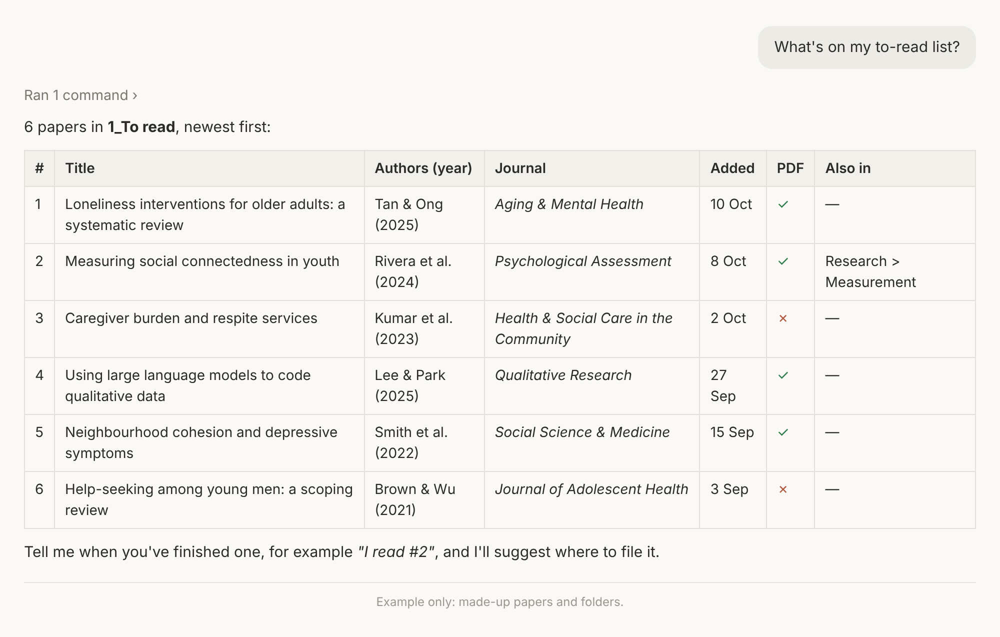
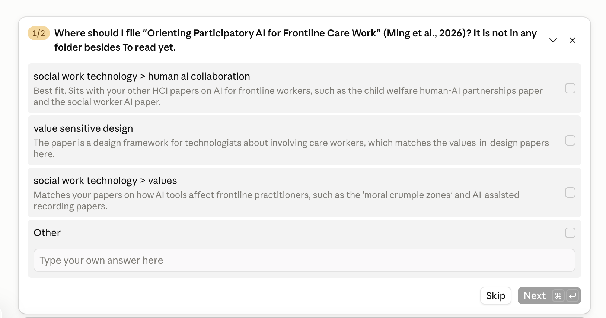

# Zotero Filer for Claude

A Claude Code plugin for people who read lots of papers and keep them in Zotero.

## Why this exists

I keep the papers I want to read in one Zotero folder ("To read"). The list grows, and
I lose track of what I have and haven't read. When I do finish a paper, filing it is a
chore: my Zotero folders go several layers deep, and I have to work out where it
belongs.

With this plugin, I just talk to Claude:

- **"What's on my to-read list?"** Claude shows the papers I haven't read yet.
- **"I finished #3."** Claude looks through my whole folder tree, suggests the best
  folder(s) with a short reason for each, and files the paper where I choose. It
  takes the paper off the to-read list and tags it `read`.
- **"Add this paper: 10.1177/…"** Claude adds a new paper (PDF, DOI, link or just a
  title) and suggests where to file it, or puts it on the to-read list.

Claude always asks before it files anything or takes something off your list. It never
deletes papers or folders.

**Example:** asking for the to-read list (made-up papers):



**Example:** after reading a paper, Claude suggests where to file it. You tick one or
more folders, or type another one under "Other":



---

## What it can do

**Your to-read list**
- Show the papers in your to-read folder: numbered, newest first, with authors, year,
  journal, and whether a PDF is attached.
- Narrow the list down ("which ones are about measurement?").
- After you read a paper: suggest folders, file it, tag it `read`, and remove it from
  the to-read folder (after asking you). The paper stays in your library.
- Do several at once ("sort the ones I've read").

**Filing with suggestions**
- Looks at all your folders, at every level (for example `PhD > Chapter 2 > Measurement`),
  and a few paper titles in each, so it knows what each folder is for.
- Suggests 1–3 folders, each with a one-line reason. You pick one or more, or type
  another.
- Can make a new folder if nothing fits.

**Adding new papers**
- From a **PDF** on your computer, a **DOI**, a **web link**, or just a **title**.
- Fills in the details (title, authors, journal, year, abstract and so on) from CrossRef.
- Checks whether the paper is already in your library first, so you don't get duplicates.
- Attaches the PDF. If you don't have one, it can look for a free, legal copy (Unpaywall).
- "Save this for later" puts it straight into your to-read folder.

**Other**
- "Check my zotero-filer setup" tests your key and finds your to-read folder.
- Works with your own library or a group library.

## Things you can say

- "What's on my to-read list?"
- "Which of my to-read papers are about loneliness?"
- "I finished the Smith 2024 paper."
- "I've read #2 and #5. Help me file them."
- "Add this to Zotero: ~/Downloads/paper.pdf"
- "Save this for later: https://doi.org/10.1037/…"
- "Add the paper 'Social isolation and mortality: a meta-analysis'."

---

## Setup

You need: Zotero (free account at zotero.org), Claude Code, and Python 3.

### 1. Make a Zotero key

1. Go to <https://www.zotero.org/settings/keys> and sign in.
2. Write down the number shown as **"Your user ID for use in API calls"**.
3. Click **"Create new private key"** and give it a name, such as `claude`.
4. Tick **"Allow library access"** and **"Allow write access"**. If you want to use a
   group library, give it access to that group too. Click **Save Key**.
5. Copy the key. Zotero shows it only once. Keep it private and never share it.

### 2. Install the plugin

Inside Claude Code, type:

```
/plugin marketplace add gerardchung/claude-zotero-filer-public-plugin
/plugin install zotero-filer@zotero-filer
```

### 3. Install two small Python packages

In Terminal (Mac) or PowerShell (Windows):

```
python3 -m pip install --user requests pypdf
```

- Windows: use `py -m pip install --user requests pypdf`.
- If you see `error: externally-managed-environment` (common on a Mac with Homebrew),
  use `python3 -m pip install --user --break-system-packages requests pypdf`.

### 4. Tell Claude your key

Open the file `~/.claude/settings.json` in a text editor. On Windows it is
`C:\Users\<your name>\.claude\settings.json`. On a Mac, this command opens it,
creating it if needed:

```
touch ~/.claude/settings.json && open -e ~/.claude/settings.json
```

Add this, using your own key and user ID:

```json
{
  "env": {
    "ZOTERO_API_KEY": "your-key",
    "ZOTERO_USER_ID": "your-user-id"
  }
}
```

If the file already has settings in it, add only the `"env"` part inside the outer
`{ }`, with a comma after the setting before it.

### 5. Check that it works

Restart Claude Code and say: **"Check my zotero-filer setup."**

Claude will tell you if the key works, if it can write, and which folder it found as
your to-read folder.

### Your to-read folder

The plugin looks for a folder called **`To read`**. It also finds names with a number
in front, like `1_To read` or `01 - To read`. If yours has another name, add this to the
same `"env"` block:

```json
"ZOTERO_TO_READ": "Reading list"
```

---

## Using it in Claude's cloud sessions (and from your phone)

Cloud sessions can't install plugins, but they do load skills from the project they open.

1. **Fork** this repository on GitHub, so you have your own copy.
2. Start a cloud session on your fork.
3. Open the cloud environment settings: click the environment name at the top of the
   session, then **Edit**.
   - **Environment variables:**
     ```
     ZOTERO_API_KEY=your-key
     ZOTERO_USER_ID=your-user-id
     ```
   - **Network access:** choose **Custom**, keep the default package managers ticked,
     and allow:
     ```
     api.zotero.org
     zoterofilestorage.s3.amazonaws.com
     api.crossref.org
     doi.org
     api.unpaywall.org
     ```
   - **Setup script:**
     ```
     pip install requests pypdf
     ```
4. Save, then start a **new** session on your fork. Settings only apply to new sessions.

More help: <https://code.claude.com/docs/en/cloud-environments>.

---

## Settings

All settings are environment variables. Put them in `~/.claude/settings.json` under
`"env"`, or in the cloud environment settings.

| Name | Needed? | What it is |
|---|---|---|
| `ZOTERO_API_KEY` | Yes | Your Zotero key (with write access) |
| `ZOTERO_USER_ID` | Yes | Your Zotero user ID (a number) |
| `ZOTERO_TO_READ` | No | Name of your to-read folder, if it isn't `To read` |
| `ZOTERO_FILER_EMAIL` | No | Your email. CrossRef asks for one as a polite contact, and Unpaywall needs one to find free PDFs |
| `ZOTERO_GROUP_ID` | No | Use a Zotero group library instead of your own |

## Updating

- Inside Claude Code: `/plugin marketplace update zotero-filer`, then `/reload-plugins`.
- Cloud: on GitHub, use **Sync fork** on your fork.

## Privacy

- Your key and user ID stay in your own settings. They are never stored in this plugin.
- The plugin only talks to:
  - **zotero.org**, for your library;
  - **CrossRef and doi.org**, to look up a paper's details from its DOI or title;
  - **Unpaywall**, only when looking for a free PDF;
  - **the web page** you give it, if you give a link.
- Your folder list is cached for one hour in `~/.cache/zotero-filer/` on your own computer,
  to keep things fast.
- Claude never deletes papers or folders, and asks before changing anything.

## Troubleshooting

| Message | What to do |
|---|---|
| `ZOTERO_API_KEY is not set` | Add the key to `settings.json` (step 4), then restart Claude Code |
| `forbidden` | Check the key and user ID, and that "Allow write access" is ticked |
| `No folder named 'To read'` | Create the folder in Zotero, or set `ZOTERO_TO_READ` |
| `Your Zotero file storage is full` | The paper was added without its PDF. Free up Zotero storage or upgrade it |
| A link doesn't work | Many publisher sites block scripts. Give the DOI or the title instead |
| Can't reach a site (cloud) | Add it to the allowed domains in the cloud environment settings |
| New folders don't show up | Say "refresh my Zotero folders" (the list is cached for one hour) |

## For developers

```
.claude-plugin/plugin.json          plugin details
.claude-plugin/marketplace.json     lets people install it with /plugin
.claude/skills/zotero-filer/
  SKILL.md                          the steps Claude follows
  scripts/zotero_tool.py            helper that talks to Zotero, CrossRef, Unpaywall
tests/                              offline tests (no network needed)
```

- Run the tests: `python3 -m pip install pytest && python3 -m pytest tests`
- `tests/test_privacy.py` fails if a file contains an email address, a key-like string,
  or a private session link.
- The helper also works on its own: `python3 .claude/skills/zotero-filer/scripts/zotero_tool.py --help`

## Licence

MIT. See [LICENSE](LICENSE).
